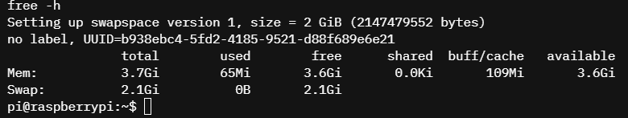

# 3. Instalación de la Raspberry Pi virtual

**Criterio de la rúbrica:** instalación de la Raspberry Pi virtual funcional,
estable y verificable (11.11%).

## 3.1 Creación del dispositivo en AVH

1. Entrar a <https://app.avh.corellium.com>.
2. Pulsar **CREATE DEVICE**.
3. Seleccionar el proyecto (normalmente **Default Project**).
4. En **Select Device**, elegir **Raspberry Pi 5** (categoría **IOT** o **ALL**).
5. En **Select an example firmware**, elegir
   **Raspberry Pi OS Desktop (11.2.0)**.
6. Pulsar **SELECT** y luego **CREATE DEVICE**.
7. Esperar a que la instancia arranque y mostrar la pantalla del escritorio o
   la consola.

La imagen disponible en AVH corresponde a **Raspberry Pi OS Desktop 11.2.0**,
basada en **Debian 11 (bullseye)**. No es Debian 13 como el CM5 del GIST, y esa
diferencia es la causa de varias adaptaciones documentadas en
[07-resolucion-problemas.md](07-resolucion-problemas.md).

## 3.2 Acceso a la consola

- Pestaña **Console** del dispositivo.
- Usuario: `pi`
- Contraseña inicial: `raspberry`

Al entrar debe aparecer un prompt similar a:

```text
pi@raspberrypi:~ $
```

> **Seguridad:** la contraseña `raspberry` es pública y conocida. En una
> instancia real se cambia con `passwd`. En esta práctica la instancia es
> efímera, pero aun así no se reutiliza esa contraseña en otros servicios.

## 3.3 Verificación del entorno

Ejecutar y guardar la salida:

```bash
uname -a
cat /etc/os-release
nproc
free -h
df -h
ip address
```

Resultados esperados:

| Comando | Resultado esperado |
|---|---|
| `uname -a` | Linux ... aarch64 GNU/Linux |
| `cat /etc/os-release` | `PRETTY_NAME="Raspberry Pi OS ... 11 (bullseye)"` |
| `nproc` | `4` |
| `free -h` | Memoria total cercana a 4 GB (3.7 GiB en la instancia usada) |
| `df -h` | Espacio suficiente para compilar OTP (varios GB) |
| `ip address` | Interfaz de red con dirección IP |

> **Memoria:** la instancia usada tiene **4 GB (3.7 GiB visibles)**, no los
> 8 GB del CM5 del GIST. Es suficiente para compilar OTP 27, pero conviene
> limitar `make` a 2 jobs (`JOBS=2`) para evitar que el enlazador se quede sin
> memoria. El script lo detecta automáticamente.

Para comprobar la salida a Internet:

```bash
ping -c 3 github.com
curl -I https://github.com
```

## 3.4 Evidencia

| Evidencia | Archivo | Qué debe verse |
|---|---|---|
| Dispositivo encendido | `evidencias/03-pi-encendida.png` | Panel de AVH con la Pi 5 en estado `on` |
| Escritorio o consola | `evidencias/03b-consola.png` | Prompt `pi@raspberrypi` |
| Datos del sistema | `evidencias/03c-uname.png` | `uname -a`, `nproc`, `free -h` |
| Versión del SO | `evidencias/03d-os-release.png` | Debian 11 / Raspberry Pi OS 11.2.0 |
| Red | `evidencias/03e-red.png` | `ip address` y `ping`/`curl` exitoso |
| RAM y swap | `evidencias/03f-free-swap.png` | `free -h` con 3.7 GiB y swap |
| Swap activo | `evidencias/03g-swap.png` | `Swap: 2.1Gi` |

Las salidas de texto también se pueden guardar en archivos:

```bash
mkdir -p evidencias/texto
uname -a                  > evidencias/texto/03-uname.txt
cat /etc/os-release       > evidencias/texto/03-os-release.txt
nproc                     > evidencias/texto/03-nproc.txt
free -h                   > evidencias/texto/03-free.txt
df -h                     > evidencias/texto/03-df.txt
ip address                > evidencias/texto/03-ip.txt
```



## 3.5 Estabilidad de la instancia

Para considerar la instalación “funcional y estable” se verificó:

- La instancia arranca sin errores y permite iniciar sesión.
- La red responde (`ping`/`curl`).
- Hay espacio suficiente para compilar OTP 27.
- La consola no se desconecta durante los comandos largos.
- La instancia se puede apagar y volver a encender sin perder el trabajo
  (mientras el trial esté activo).

## 3.6 Reflexión breve

La diferencia entre “tener una máquina virtual” y “tener un entorno de
desarrollo funcional” está en la verificación. No basta con que la pantalla
arranque: hay que comprobar arquitectura, núcleos, memoria, disco, red y
permisos. Esa lista de comprobaciones evitó descubrir problemas a mitad de la
compilación de OTP, que es la parte más costosa en tiempo.

## 3.7 Lista de verificación

- [ ] Dispositivo Raspberry Pi 5 creado.
- [ ] Firmware Raspberry Pi OS Desktop 11.2.0.
- [ ] Consola accesible con `pi`.
- [ ] `uname -m` = `aarch64`.
- [ ] `nproc` = 4.
- [ ] Memoria y disco verificados.
- [ ] Red verificada.
- [ ] Capturas y salidas guardadas.
