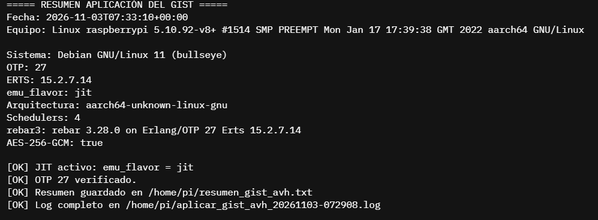

# 4. Aplicación del GIST del docente

**Criterio de la rúbrica:** aplicar el GIST del docente, interpretar sus
instrucciones y validar que los cambios se integren al entorno (11.11%).

**GIST original:**
<https://gist.github.com/IoTeacher/3c3607e48bce473de9bfa6d400dec6ff>

## 4.1 Qué hace el GIST

El GIST es una guía de instalación de **Erlang/OTP 27 con JIT nativo ARM64**
para una **Raspberry Pi CM5 física con Debian 13 (trixie)**. Sus pasos
principales son:

1. Instalar dependencias de compilación con `apt`.
2. Instalar `asdf` como gestor de versiones.
3. Compilar OTP 27.3.4.19 con JIT mediante `asdf install erlang`.
4. Instalar `rebar3`.
5. Crear un proyecto de prueba con `rebar3 new release hello_erlang`.
6. (Opcional) Configurar dependencias de producción, sysctl, límites, systemd,
   recon y TLS.

El GIST **no contiene la práctica de los diez problemas**. Es una guía de
preparación del entorno. Por eso esta actividad se limita a aplicar el GIST y
validar el entorno, sin mezclarlo con el proyecto anterior.

## 4.2 Diferencias entre el GIST y AVH

| Tema | GIST | AVH real | Decisión |
|---|---|---|---|
| Equipo | CM5 físico | Raspberry Pi 5 virtual | Se usa la Pi 5 virtual; misma familia Cortex-A76 |
| SO | Debian 13 (trixie) | Debian 11 (bullseye) | Se adaptan paquetes y repositorios |
| Erlang de apt | OTP 27 | OTP 23 | Se compila OTP 27 desde fuente, como pide el GIST |
| `libwxgtk3.2-dev` | Disponible | No existe (hay 3.0) | Se omite wx y se compila `--without-wx` |
| gcc | ≥ 11 | 10.2 | Se intenta JIT; si falla, se usa clang o `--disable-jit` |
| systemd | Usuario `distiller` | No existe | Se documenta como paso de producción, no se usa |
| `rebar3` en apt | Sí | No | Se descarga el escript oficial |

## 4.3 Pasos aplicados

### Paso 0 — Arreglar los repositorios de Debian 11

Antes de instalar cualquier paquete fue necesario corregir `apt`, porque
bullseye ya está archivado:

```bash
sudo cp /etc/apt/sources.list /etc/apt/sources.list.bak
sudo sed -i \
  -e 's|https*://deb.debian.org/debian|http://archive.debian.org/debian|g' \
  -e 's|https*://security.debian.org/debian-security|http://archive.debian.org/debian-security|g' \
  /etc/apt/sources.list /etc/apt/sources.list.d/*.list 2>/dev/null || true
echo 'Acquire::Check-Valid-Until "false";' | sudo tee /etc/apt/apt.conf.d/99archive
sudo apt-get update
```

Esto se automatizó en `scripts/arreglar_apt_bullseye.sh`.

### Paso 1 — Dependencias del sistema

El GIST instala, entre otras:

```text
build-essential libssl-dev libncurses-dev libwxgtk3.2-dev
libgl1-mesa-dev libglu1-mesa-dev libpng-dev libssh-dev
unixodbc-dev xsltproc fop git curl wget
```

Adaptación para AVH:

```bash
sudo apt-get install -y \
  build-essential libssl-dev libncurses-dev libssh-dev \
  unixodbc-dev git curl wget ca-certificates m4
```

Se omitieron `libwxgtk3.2-dev`, `libgl1-mesa-dev`, `libglu1-mesa-dev`,
`libpng-dev`, `xsltproc` y `fop` porque no son necesarios para compilar OTP
sin GUI y porque `libwxgtk3.2-dev` no existe en bullseye.

### Paso 2 — Instalar asdf

Igual que el GIST, con la versión v0.14.1:

```bash
git clone https://github.com/asdf-vm/asdf.git ~/.asdf --branch v0.14.1
grep -q 'asdf.sh'   ~/.bashrc || echo '. "$HOME/.asdf/asdf.sh"'               >> ~/.bashrc
grep -q 'asdf.bash' ~/.bashrc || echo '. "$HOME/.asdf/completions/asdf.bash"' >> ~/.bashrc
source ~/.bashrc
asdf --version
asdf plugin add erlang https://github.com/asdf-vm/asdf-erlang.git
```

Resultado esperado: `v0.14.1` y el plugin `erlang` listado.

### Paso 3 — Compilar OTP 27 con JIT

El GIST usa:

```bash
KERL_CONFIGURE_OPTIONS="--enable-native-libs \
  --enable-kernel-poll \
  --disable-debug \
  --without-javac" \
asdf install erlang 27.3.4.19
```

Adaptación para AVH (se agrega `--without-wx`):

```bash
KERL_CONFIGURE_OPTIONS="--enable-native-libs \
  --enable-kernel-poll \
  --disable-debug \
  --without-javac \
  --without-wx" \
MAKEFLAGS="-j2" \
asdf install erlang 27.3.4.19

asdf global erlang 27.3.4.19
asdf reshim erlang
```

> `MAKEFLAGS="-j2"` limita la compilación a dos procesos. Es recomendable en
> la instancia de 4 GB para no agotar la memoria durante el enlazado.

Verificación:

```bash
erl -noshell -eval '
  io:format("OTP Release : ~s~n",  [erlang:system_info(otp_release)]),
  io:format("JIT flavor  : ~p~n",  [erlang:system_info(emu_flavor)]),
  io:format("Arch        : ~s~n",  [erlang:system_info(system_architecture)]),
  halt().'
```

Salida esperada:

```text
OTP Release : 27
JIT flavor  : jit
Arch        : aarch64-unknown-linux-gnu
```

Si `emu_flavor` es `emu`, el JIT no se compiló. En ese caso se documenta el
motivo y se aplica el respaldo `--disable-jit`, que deja OTP 27 funcional pero
sin JIT.

### Paso 4 — Instalar rebar3

El GIST descarga el escript oficial:

```bash
mkdir -p ~/bin
wget https://s3.amazonaws.com/rebar3/rebar3 -O ~/bin/rebar3
chmod +x ~/bin/rebar3
grep -q 'HOME/bin' ~/.bashrc || echo 'export PATH="$HOME/bin:$PATH"' >> ~/.bashrc
source ~/.bashrc
rebar3 --version
```

Resultado esperado: `rebar 3.x.x on Erlang/OTP 27 Erts 15.x`.

### Paso 5 — Proyecto de prueba

```bash
cd ~
rebar3 new release hello_erlang
cd hello_erlang
rebar3 compile
rebar3 release
rebar3 tar
```

Resultado esperado: compilación exitosa y release generado en
`_build/default/rel/hello_erlang/` (o `_build/prod/rel/...` según configuración).

### Paso 6 — sysctl y límites (adaptado)

El GIST propone ajustes de red y límites de archivos. Se aplicaron los valores
de `sysctl` y se adaptó el archivo de límites al usuario real (`pi`), no a
`distiller`:

```bash
sudo tee /etc/sysctl.d/99-erlang.conf > /dev/null <<'EOF'
net.core.somaxconn = 65535
net.ipv4.tcp_max_syn_backlog = 65535
net.ipv4.ip_local_port_range = 1024 65535
net.ipv4.tcp_fin_timeout = 15
net.ipv4.tcp_tw_reuse = 1
net.core.rmem_max = 16777216
net.core.wmem_max = 16777216
net.ipv4.tcp_rmem = 4096 87380 16777216
net.ipv4.tcp_wmem = 4096 65536 16777216
EOF
sudo sysctl -p /etc/sysctl.d/99-erlang.conf
```

### Paso 7 — Verificación de crypto AES

```bash
erl -noshell -eval '
  ok = crypto:start(),
  Ciphers = crypto:supports(ciphers),
  io:format("AES-256-GCM   : ~p~n", [lists:member(aes_256_gcm, Ciphers)]),
  io:format("ChaCha20-Poly : ~p~n", [lists:member(chacha20_poly1305, Ciphers)]),
  halt().'
```

Resultado esperado: `true` en ambos casos.

## 4.4 Resultados obtenidos

| Verificación | Resultado |
|---|---|
| Compilador | gcc 10.2.1 (Debian 11) |
| `asdf --version` | v0.14.1 (instalado por el script) |
| OTP Release | 27 |
| ERTS | 15.2.7.14 |
| `emu_flavor` | **`jit`** |
| `system_architecture` | `aarch64-unknown-linux-gnu` |
| `schedulers_online` | 4 |
| `rebar3 --version` | rebar 3.28.0 on Erlang/OTP 27 Erts 15.2.7.14 |
| `rebar3 compile` en `hello_erlang` | Compilación exitosa |
| AES-256-GCM | `true` |
| ChaCha20-Poly1305 | `true` |

## 4.5 Evidencia

| Evidencia | Archivo |
|---|---|
| Script ejecutándose / pasos | `evidencias/04-gist-ejecucion.png` |
| `asdf` y plugin erlang | `evidencias/04b-asdf.png` |
| Compilación de OTP 27 | `evidencias/04c-otp-build.png` |
| Verificación de OTP y JIT | `evidencias/04d-jit.png` ✅ |
| rebar3 y `hello_erlang` | `evidencias/04e-rebar3.png` |
| Crypto AES | `evidencias/04f-crypto.png` |
| Log del script | `evidencias/logs/aplicar_gist.log` |
| Resumen del script | `evidencias/texto/04-resumen-gist.txt` ✅ |



> El log se genera automáticamente en `~/aplicar_gist_avh_<fecha>.log` y se
> copia a `evidencias/logs/aplicar_gist.log`.

## 4.6 Interpretación

El GIST se aplicó en su totalidad en lo que respecta al entorno de desarrollo:
dependencias, `asdf`, OTP 27, `rebar3` y proyecto de prueba. Los pasos de
producción (systemd con usuario `distiller`, TLS, recon) se revisaron y se
adaptaron o se documentaron como opcionales, porque no son necesarios para
validar la instalación y porque presuponen un usuario y un release que no
existen en la imagen de AVH.

La adaptación más importante fue reconocer que **AVH no es un CM5 físico** y
que **Debian 11 no es Debian 13**. Aplicar el GIST sin esos ajustes habría
fallado en el primer `apt install`.

## 4.7 Lista de verificación

- [ ] Repositorios de Debian 11 corregidos.
- [ ] Dependencias instaladas.
- [ ] `asdf` v0.14.1 instalado.
- [ ] Plugin `erlang` agregado.
- [ ] OTP 27.3.4.19 compilado.
- [ ] `emu_flavor` verificado.
- [ ] `rebar3` instalado.
- [ ] `hello_erlang` creado y compilado.
- [ ] Crypto AES verificado.
- [ ] Log y capturas guardados.
