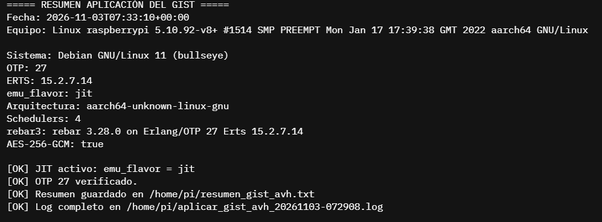
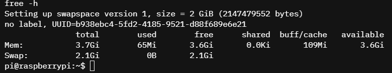
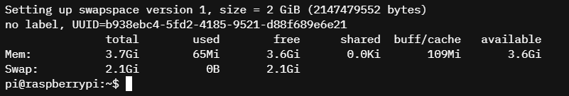

# 6. Evidencias técnicas del proceso

**Criterio de la rúbrica:** presentar evidencias claras, ordenadas y
verificables como capturas, comandos, registros, URLs y resultados de
ejecución (11.11%).

## 6.1 Convención de nombres

Todas las evidencias viven en `evidencias/`. Se usa un prefijo numérico que
coincide con el criterio de la rúbrica:

```text
evidencias/
├── 03f-free-swap.png
├── 03g-swap.png
├── 04d-jit.png
├── README.md
└── texto/
    ├── 04-crypto.txt
    ├── 04-erl-version.txt
    ├── 04-gcc.txt
    ├── 04-rebar3-compile.txt
    ├── 04-rebar3-version.txt
    └── 04-resumen-gist.txt
```

> **Alcance real de las evidencias.** La entrega incluye **tres capturas de
> consola** y **seis salidas de texto**. No se incluyen capturas del panel web
> de AVH (cuenta ARM, trial, lista de dispositivos) ni el log completo, porque
> la instancia se apagó antes de recuperarlos. Esta limitación se documenta de
> forma explícita en lugar de simular evidencias que no existen.

## 6.2 Lista de evidencias

| # | Evidencia | Archivo | Estado |
|---|---|---|---|
| 1 | Cuenta ARM verificada | `evidencias/01-cuenta-arm.png` | ➖ No disponible |
| 2 | Acceso a AVH por SSO | `evidencias/01b-acceso-avh.png` | ➖ No disponible |
| 3 | Trial de 30 días | `evidencias/02-demo-corellium.png` | ➖ No disponible |
| 4 | Dispositivo Raspberry Pi 5 | `evidencias/02b-dispositivo.png` | ➖ No disponible |
| 5 | Pi encendida en AVH | `evidencias/03-pi-encendida.png` | ➖ No disponible |
| 6 | Consola de la Pi | `evidencias/03b-consola.png` | ➖ No disponible |
| 7 | `uname`, `nproc`, `free` | `evidencias/03c-uname.png` | ➖ Parcial (ver `03f`) |
| 8 | Versión de Debian | `evidencias/03d-os-release.png` | ➖ Sustituida por texto |
| 9 | Red funcionando | `evidencias/03e-red.png` | ➖ No disponible |
| 10 | Aplicación del GIST | `evidencias/04-gist-ejecucion.png` | ➖ No disponible |
| 11 | asdf y plugin erlang | `evidencias/04b-asdf.png` | ➖ No disponible |
| 12 | Compilación de OTP | `evidencias/04c-otp-build.png` | ➖ Sustituida por resumen |
| 13 | Verificación de JIT | `evidencias/04d-jit.png` | ✅ Incluida |
| 14 | rebar3 y hello_erlang | `evidencias/04e-rebar3.png` | ➖ Sustituida por texto |
| 15 | Crypto AES | `evidencias/04f-crypto.png` | ➖ Sustituida por texto |
| 16 | Sesión de OpenCode | `evidencias/05-opencode.png` | ➖ No disponible |
| 17 | Diagnóstico del 404 | `evidencias/05b-diagnostico.png` | ➖ Documentado en `07` |
| 18 | Log completo | `evidencias/logs/aplicar_gist.log` | ➖ No recuperado |
| 19 | Resumen del script | `evidencias/texto/04-resumen-gist.txt` | ✅ Incluido |
| 20 | Swap y memoria (`free -h`) | `evidencias/03f-free-swap.png` | ✅ Incluida |
| 21 | Swap activo (2.1 GiB) | `evidencias/03g-swap.png` | ✅ Incluida |

### Evidencias de texto ya recopiladas

| Evidencia | Archivo | Estado |
|---|---|---|
| Versión de Erlang/ERTS | `evidencias/texto/04-erl-version.txt` | ✅ Listo |
| Versión de rebar3 | `evidencias/texto/04-rebar3-version.txt` | ✅ Listo |
| AES-256-GCM y ChaCha20 | `evidencias/texto/04-crypto.txt` | ✅ Listo |
| Compilador gcc | `evidencias/texto/04-gcc.txt` | ✅ Listo |
| Compilación de `hello_erlang` | `evidencias/texto/04-rebar3-compile.txt` | ✅ Listo |
| Resumen del GIST | `evidencias/texto/04-resumen-gist.txt` | ✅ Listo |

Las capturas de consola adjuntas son las tres únicas disponibles. Las
capturas del panel web (cuenta ARM, trial, dispositivo) no se tomaron antes de
apagar la instancia, y el log completo quedó en el disco de la Pi virtual.
Ambas ausencias se declaran aquí para que la entrega sea verificable y honesta:
lo que no existe no se presenta como si existiera.

La evidencia técnica principal se conserva en texto: el resumen del script, las
versiones de Erlang y rebar3, la comprobación de AES/ChaCha, la versión de gcc y
la compilación de `hello_erlang`.

## 6.3 Cómo generar las salidas de texto

En la consola de la Pi, dentro del repositorio:

```bash
mkdir -p evidencias/texto

uname -a                  | tee evidencias/texto/03-uname.txt
cat /etc/os-release       | tee evidencias/texto/03-os-release.txt
nproc                     | tee evidencias/texto/03-nproc.txt
free -h                   | tee evidencias/texto/03-free.txt
df -h                     | tee evidencias/texto/03-df.txt
ip address                | tee evidencias/texto/03-ip.txt

erl -noshell -eval '
  io:format("OTP: ~s~n", [erlang:system_info(otp_release)]),
  io:format("ERTS: ~s~n", [erlang:system_info(version)]),
  io:format("Flavor: ~p~n", [erlang:system_info(emu_flavor)]),
  io:format("Arch: ~s~n", [erlang:system_info(system_architecture)]),
  io:format("Schedulers: ~p~n", [erlang:system_info(schedulers_online)]),
  halt().' | tee evidencias/texto/04-otp.txt

rebar3 --version          | tee evidencias/texto/04-rebar3.txt
```

## 6.4 Cómo tomar capturas útiles

1. **Captura completa de la ventana**, no solo un fragmento.
2. Incluye la barra de URL cuando sea relevante (cuenta ARM, AVH).
3. Incluye el prompt `pi@raspberrypi` y el comando ejecutado, no solo la
   salida. Así se demuestra que el resultado es de la Pi virtual.
4. Si la salida es larga (compilación de OTP), captura el inicio y el final,
   y adjunta el log completo.
5. Recorta o difumina correo, identificadores de cuenta, tokens y cookies.
6. Usa PNG para capturas y TXT para salidas de terminal.

## 6.5 Cómo se copiaron las capturas al repositorio

Las tres capturas se copiaron desde la carpeta de Windows accesible por WSL:

```bash
cd /home/carprez/practica-avh-corellium
cp "/mnt/c/Users/Admin/OneDrive/Pictures/Screenshots/Captura de pantalla 2026-11-02 233721.png" evidencias/04d-jit.png
cp "/mnt/c/Users/Admin/OneDrive/Pictures/Screenshots/Captura de pantalla 2026-11-02 232001.png" evidencias/03f-free-swap.png
cp "/mnt/c/Users/Admin/OneDrive/Pictures/Screenshots/Captura de pantalla 2026-11-02 231943.png" evidencias/03g-swap.png
git add evidencias
git commit -m "Adjuntar capturas de consola"
git push
```

Si en el futuro se dispone de las capturas del panel web, se pueden añadir con
los nombres de la tabla. En esta entrega no existen y por eso no se enlazan.

## 6.6 Evidencias que no deben publicarse

- Correo completo sin difuminar.
- Contraseñas o frases de recuperación.
- Tokens de GitHub, Arm o Corellium.
- Cookies de sesión.
- Llaves privadas SSH.
- Identificadores de cuenta o facturación.

Si una captura contiene alguno de esos datos, se edita antes de hacer `git
add`. Ver [08-seguridad.md](08-seguridad.md).

## 6.7 Estado de las evidencias

La entrega quedó cerrada con este alcance:

> Se adjuntan tres capturas de consola (`04d-jit.png`, `03f-free-swap.png` y
> `03g-swap.png`) y seis salidas de texto. Los resultados coinciden con las
> tablas de [04-aplicacion-gist.md](04-aplicacion-gist.md). Las capturas del
> panel web y el log completo no se recuperaron porque la instancia de AVH se
> apagó al terminar la práctica.

## 6.8 Lista de verificación

- [x] Carpeta `evidencias/` creada.
- [x] Capturas de consola adjuntas con nombres claros.
- [x] Salidas de texto en `evidencias/texto/`.
- [ ] Log completo en `evidencias/logs/` (no recuperado).
- [x] Datos sensibles revisados: las capturas no muestran correo, tokens ni
      contraseñas.
- [x] Enlaces del README verificados.

## 6.9 Capturas de consola ya adjuntas

Estas capturas se tomaron directamente de la consola de la Raspberry Pi 5
virtual y no contienen datos personales.

### Verificación del JIT



Se observa `emu_flavor: jit`, OTP 27, ERTS 15.2.7.14, arquitectura
`aarch64-unknown-linux-gnu`, 4 schedulers y `AES-256-GCM: true`.

### Memoria y swap





La instancia tiene **3.7 GiB de RAM** y se añadieron **2.1 GiB de swap** para
compilar OTP 27 sin agotar la memoria. Esto confirma que la instancia es de
4 GB y no de 8 GB como sugería la documentación inicial.
